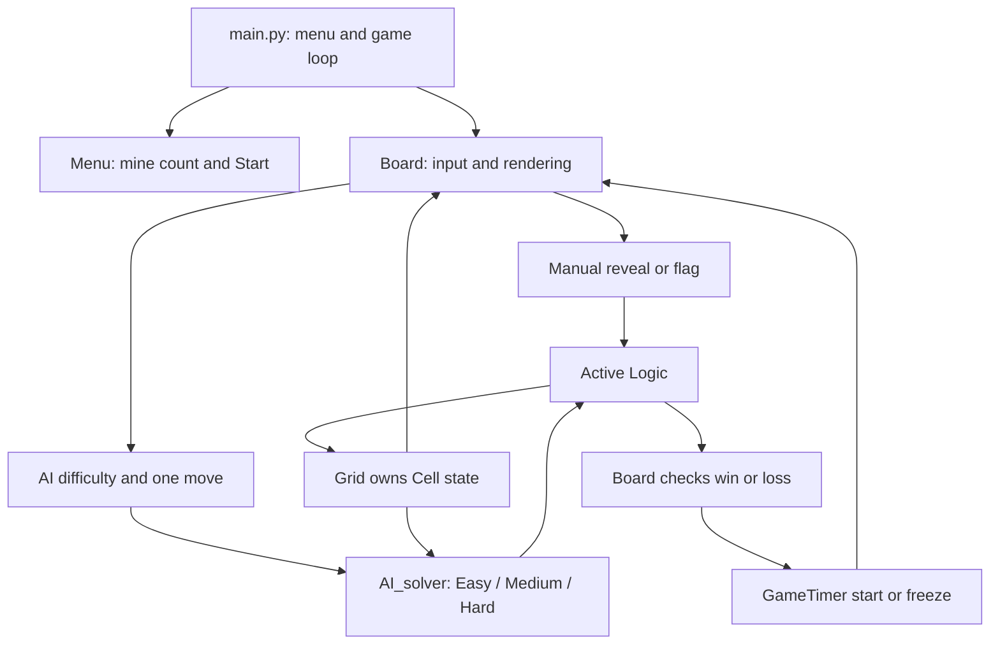
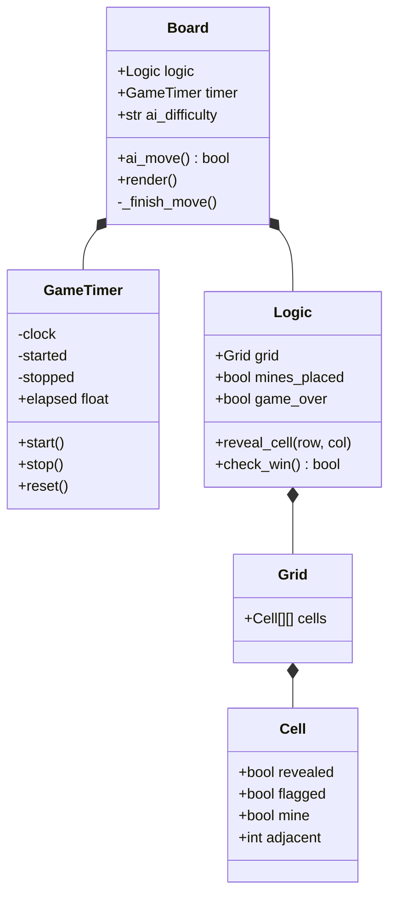

# Project 2 design

Author of these additions: Han Zheng. Date: 2026-10-11.
Purpose: document the Project 2 architecture, AI and elapsed timer.
Inputs: player/AI actions and the current board. Outputs: game state and rendering.
External source: OpenAI Codex assisted maintenance, tests and this documentation.
Original source authorship and inherited Project 1 documentation are retained.

## Architecture and data flow

`main.py` owns the current `Menu` and `Board`. Starting or resetting constructs a
fresh Board. The Board owns one `Logic`, its `Grid`/`Cell` objects, and one timer.
Manual input and every AI difficulty operate on that same Logic instance.
AI functions moved from the repository root to `src/AI_solver.py` so the documented
`python src/main.py` command resolves imports without modifying PYTHONPATH.

`Logic.reveal_cell` ignores revealed/flagged cells and ended games before placing
mines. Its first valid reveal calls `place_mines` with that cell as the safe center;
the center and its in-bounds neighbors are excluded. `mines_placed` prevents
regeneration, including during recursive zero reveals. Board synchronizes its
existing `first_click`/`win` fields and reveals all mines on a loss. Reset creates
a new board/timer and retains the AI level; returning to the menu ends that session.

## AI solver

Original AI contributions: Mason (Easy), Sione (Medium and neighbors), Austin
(Hard). Han Zheng repaired and integrated those contributions, preserving attribution.

- **Easy:** build all covered, unflagged coordinates, randomly choose one, and call
  the active Logic's reveal method. No legal cell or an ended game means no action.
- **Medium Rule 1:** for each revealed safe clue, if its total covered neighbors
  (including flags) equal its number, flag the unflagged covered neighbors.
- **Medium Rule 2:** if its flagged neighbors equal its number, reveal its remaining
  covered, unflagged neighbors. Zero clues also apply. Stop a reveal batch on loss.
- **Medium fallback:** if no deduction changes a cell, use Easy.
- **Hard:** try a horizontal or vertical revealed 1-2-1 on either side. The middle
  clue must see exactly the three covered cells of the candidate strip; each end
  clue can also see the exterior continuation of that strip, but no other hidden
  cells. The opposite side is therefore closed. The two outer candidate cells are
  flagged and the middle is revealed. Existing outer flags stay set; a flagged
  middle or exterior rejects this pattern. If no valid pattern applies, use Medium.

Why the bounded rule is sound: the middle clue requires two mines among the three
candidates. Adding the two end-clue constraints counts the middle candidate twice,
and can only add nonnegative exterior mine counts. Since that sum is also two,
the middle and exterior cells are safe; both outer candidates must be mines.
An arbitrary visible 1-2-1 with other unknown neighbors does not justify this rule.
All neighbor/target coordinates are checked before access; there is no unbounded
Hard loop. Inference reads hidden cells' revealed/flagged state, not hidden mines.
Revealed mine checks only avoid treating loss-state mines as clues.

An AI action applies one deduction batch or one random selection. Recursive zero
reveal may expose several cells. AI is a move aid, not a guarantee of winning:
random fallback or incorrect human flags can still lose.

## Custom feature: elapsed game timer

The existing coordinate labels were already recorded in Project 1. They are
preserved; the new Project 2 custom feature is the elapsed timer.

- A Board starts with zero elapsed time; opening the board or flagging alone does
  not start the timer. The first valid human or AI reveal starts it.
- A monotonic clock measures elapsed seconds, independent of wall-clock changes.
- Repeated start/stop calls do not change the original timestamps.
- Win/loss freezes elapsed time. A new Board on Reset/new game resets it to zero.
- The top bar displays whole elapsed seconds; both input paths finish through
  the same Board synchronization method.

## Attribution and hours

Source headers preserve inherited authors and Han's recorded maintenance
attribution. Codex assisted Han's final repair, integration, timer, tests and
Project 2 documentation. The title image's existing ChatGPT attribution and
Board's existing Claude attribution are retained.

`hours_estimate.md` and `hours_log.md` retain their inherited Project 1 records.
[Project 2 actual person-hours](project2_hours_log.md) reproduces all nine entries
from the authoritative user-provided `Person Hours Log.pdf`, preserving the
original names, dates, time ranges and descriptions.

The team confirmed that no earlier Project 2 estimate existed. The
[task-based Project 2 estimate](project2_hours_estimate.md) documents the supplied
13.0 estimated person-hours by work item, based on complexity, integration,
testing and documentation. It does not invent individual estimates or change
actual logged hours.
